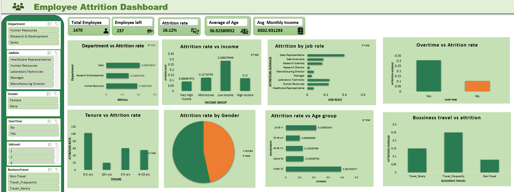
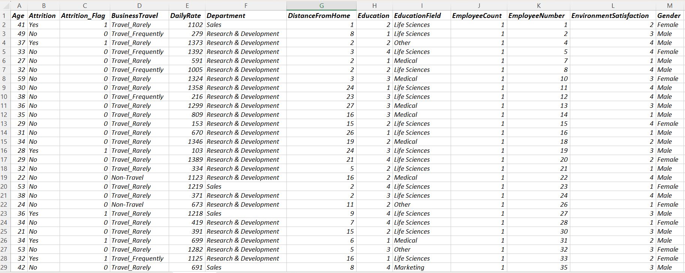
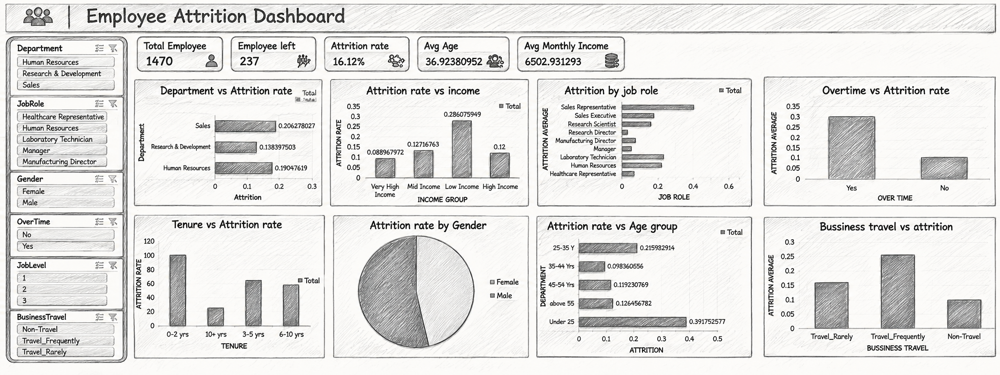

# Employee Attrition Analysis Dashboard

**An interactive Excel dashboard designed to analyse employee attrition and identify patterns influencing employee turnover.**

## Project Preview

## Project Overview

This project analyses employee attrition using a dataset of 1,470 employees. It provides insights into employee turnover across departments, age groups, income, and overtime.

## From Data to Dashboard

The project started with an employee dataset, followed by data exploration, analysis using PivotTables, and dashboard development in Microsoft Excel.

### Source Data

### Dashboard Sketch

## Dashboard Features

- Interactive slicers for filtering data.
- KPI cards.
- Department-wise attrition analysis.
- Age-group-wise attrition analysis.
- Overtime-based attrition comparison.
- Average age and monthly income analysis.

## Files Included

| File | Description |
|---|---|
| `Excel-dashboard.xlsx.xlsx` | Complete Excel workbook with dashboard and PivotTables |
| `DASHBOARD-IMAGE.PNG.png` | Final dashboard screenshot |
| `Dashboard-sketch.png.png` | Initial dashboard sketch |
| `Data.png.png` | Source data preview |
| `README.md` | Project documentation |

## How to Download and Use

1. Download `Excel-dashboard.xlsx.xlsx` from this repository.
2. Open it using Microsoft Excel.
3. Navigate to the dashboard worksheet.
4. Use the available slicers to explore the data.

[Download the Excel Dashboard](Excel-dashboard.xlsx.xlsx)

## Tools and Skills

- Microsoft Excel
- Data Analysis
- PivotTables
- PivotCharts
- Slicers
- KPI Development
- Data Visualization
- Dashboard Design
